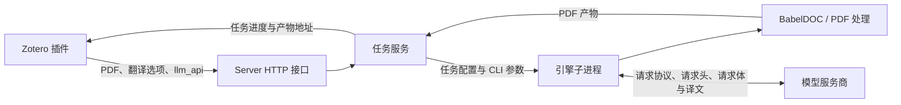

<div align="center">


<h2 id="title">Zotero PDF2zh</h2>

[](https://www.zotero.org)
[](https://www.zotero.org/support/beta_builds)
[](https://www.zotero.org/support/beta_builds)
[](https://www.zotero.org/support/beta_builds)

[](https://github.com/windingwind/zotero-plugin-template)


[](https://github.com/guaguastandup/zotero-pdf2zh/blob/main/LICENSE)
[![zread](https://img.shields.io/badge/Ask_Zread-_.svg?style=flat&color=00b0aa&labelColor=000000&logo=data%3Aimage%2Fsvg%2Bxml%3Bbase64%2CPHN2ZyB3aWR0aD0iMTYiIGhlaWdodD0iMTYiIHZpZXdCb3g9IjAgMCAxNiAxNiIgZmlsbD0ibm9uZSIgeG1sbnM9Imh0dHA6Ly93d3cudzMub3JnLzIwMDAvc3ZnIj4KPHBhdGggZD0iTTQuOTYxNTYgMS42MDAxSDIuMjQxNTZDMS44ODgxIDEuNjAwMSAxLjYwMTU2IDEuODg2NjQgMS42MDE1NiAyLjI0MDFWNC45NjAxQzEuNjAxNTYgNS4zMTM1NiAxLjg4ODEgNS42MDAxIDIuMjQxNTYgNS42MDAxSDQuOTYxNTZDNS4zMTUwMiA1LjYwMDEgNS42MDE1NiA1LjMxMzU2IDUuNjAxNTYgNC45NjAxVjIuMjQwMUM1LjYwMTU2IDEuODg2NjQgNS4zMTUwMiAxLjYwMDEgNC45NjE1NiAxLjYwMDFaIiBmaWxsPSIjZmZmIi8%2BCjxwYXRoIGQ9Ik00Ljk2MTU2IDEwLjM5OTlIMi4yNDE1NkMxLjg4ODEgMTAuMzk5OSAxLjYwMTU2IDEwLjY4NjQgMS42MDE1NiAxMS4wMzk5VjEzLjc1OTlDMS42MDE1NiAxNC4xMTM0IDEuODg4MSAxNC4zOTk5IDIuMjQxNTYgMTQuMzk5OUg0Ljk2MTU2QzUuMzE1MDIgMTQuMzk5OSA1LjYwMTU2IDE0LjExMzQgNS42MDE1NiAxMy43NTk5VjExLjAzOTlDNS42MDE1NiAxMC42ODY0IDUuMzE1MDIgMTAuMzk5OSA0Ljk2MTU2IDEwLjM5OTlaIiBmaWxsPSIjZmZmIi8%2BCjxwYXRoIGQ9Ik0xMy43NTg0IDEuNjAwMUgxMS4wMzg0QzEwLjY4NSAxLjYwMDEgMTAuMzk4NCAxLjg4NjY0IDEwLjM5ODQgMi4yNDAxVjQuOTYwMUMxMC4zOTg0IDUuMzEzNTYgMTAuNjg1IDUuNjAwMSAxMS4wMzg0IDUuNjAwMUgxMy43NTg0QzE0LjExMTkgNS42MDAxIDE0LjM5ODQgNS4zMTM1NiAxNC4zOTg0IDQuOTYwMVYyLjI0MDFDMTQuMzk4NCAxLjg4NjY0IDE0LjExMTkgMS42MDAxIDEzLjc1ODQgMS42MDAxWiIgZmlsbD0iI2ZmZiIvPgo8cGF0aCBkPSJNNCAxMkwxMiA0TDQgMTJaIiBmaWxsPSIjZmZmIi8%2BCjxwYXRoIGQ9Ik00IDEyTDEyIDQiIHN0cm9rZT0iI2ZmZiIgc3Ryb2tlLXdpZHRoPSIxLjUiIHN0cm9rZS1saW5lY2FwPSJyb3VuZCIvPgo8L3N2Zz4K&logoColor=ffffff)](https://zread.ai/guaguastandup/zotero-pdf2zh)

在 Zotero 中直接使用 [PDF2zh](https://github.com/Byaidu/PDFMathTranslate) 与 [PDF2zh_next](https://github.com/PDFMathTranslate-next/PDFMathTranslate-next) 翻译 PDF，保留公式与排版，并提供双语对照、裁剪阅读、批量翻译与多种 LLM 服务配置。

**📚 项目文档：** [zotero-pdf2zh.github.io](https://zotero-pdf2zh.github.io)

**📝 其他语言 / Other Languages:**

[English](./i18n/README.en.md) | [日本語](./i18n/README.ja.md) | [한국어](./i18n/README.ko.md) | [Italiano](./i18n/README.it.md) | [Français](./i18n/README.fr.md)

> **Note:** The translations above were generated by AI and may contain inaccuracies. For the most accurate information, please refer to this document.
>
> 


>
> 📢 重要通知(2026年8月19日): 本插件正在进行全面重构，预期九月份发布新版本，暂时不会在群里及时解答目前版本相关的问题，请自行向AI提问或阅读本文档～也请开发者暂时不要对本仓库提交贡献，因为无法和新版本进行合并。
>
> 
>
> 📦 **上游发布包：** [Zotero 插件 XPI](https://github.com/guaguastandup/zotero-pdf2zh/releases/latest/download/zotero-pdf-2-zh.xpi) · [Server](https://github.com/guaguastandup/zotero-pdf2zh/releases/latest/download/server.zip) · [完整文档](https://zotero-pdf2zh.github.io/)

</div>

## 本地构建与更新

当前维护版本为 **4.1.9-beta.7**。本仓库发布入口：[GitHub Release](https://github.com/yankang104/zotero-pdf2zh/releases/tag/v4.1.9-beta.7) · [插件 XPI](https://github.com/yankang104/zotero-pdf2zh/releases/download/v4.1.9-beta.7/zotero-pdf-2-zh.xpi) · [Server](https://github.com/yankang104/zotero-pdf2zh/releases/download/v4.1.9-beta.7/server.zip)。

本地构建的两个安装包统一放在项目根目录，固定保留一份：[插件 XPI](./zotero-pdf-2-zh.xpi) 和 [Server](./server.zip)。

```shell
cd plugin
npm run build
cd ..
python pack_server.py
```

插件构建结束后自动将 XPI 移到项目根目录，两个安装包重复构建均覆盖同名文件。发布时统一插件与 Server 版本号，推送对应版本标签。发布流程将安装包上传到 GitHub Releases，并在 `zotero-updates` 分支更新 `update-beta.json`，供 Zotero 获取测试版更新。

安装 `4.1.9-beta.7` 后，可在 Zotero 的“工具 → 插件”中选择“检查更新”或启用自动更新。从旧更新地址切换到新通道时（包括本仓库的 `4.1.9-beta.6`），直接覆盖安装一次上述 XPI，无需先卸载插件。Server 更新仍需将 `server.zip` 内的 `server` 目录合并到现有目录后重启 Server，继续使用已有翻译环境。

LLM API 编辑器由服务商、API Key、Base URL、模型、请求头和请求体六块组成。主设置只保留一个翻译服务下拉；下方管理器按配置条目新增、编辑、删除、激活或置顶。选择主服务、选择管理器条目和激活配置各自独立，同一服务商最多一条配置激活，不同服务商可以同时激活。

编辑器与主设置共用服务商目录，新建时默认使用当前翻译服务。内置服务在同一个框内显示名称；选择右侧 ▼ 中的「＋ 自定义服务商…」后，同框可输入自己的配置名称。URL 单独填写，空地址或上一站点默认地址会随内置服务切换，手填地址保留。模型和 URL 支持输入及原生下拉，Key 使用密码输入框，模型与「获取模型」按钮同行。请求头和请求体默认折叠，提供 Key/Value 行、常用值及模板；底部的「保存并使用」会保存并激活该配置，同时切换主设置的翻译服务。

「获取模型」由 Zotero 直接访问服务商，使用当前未保存的 URL、Key、认证和请求头，不需要先启动 Server，也不解析尚未填写完整的翻译请求体。获取结果加入模型候选，手填模型继续保留。请求体展开区中的「翻译参数」可编辑原有超时、思考模式等业务字段；内置服务使用原生翻译接口，自定义协议和请求头、请求体用于 OpenAI、OpenAI-Liked 及自定义服务商。

服务商名称、保存与使用、模型获取见[配置说明](./docs/zh/guide/configuration.md)；请求体的九个协议/模板组合、请求头和原有业务参数见[额外参数说明](./docs/zh/guide/extra-params.md)。源码职责记录在 [Server 参数文档](./docs/development/extraData.md)。

### 项目结构与调用链

项目按业务功能组织。完整目录、依赖方向、配置边界与维护入口见[开发架构说明](./docs/development/architecture.md)。

| 目录 | 维护职责 |
| --- | --- |
| `plugin/src/settings/` | 配置唯一内存状态、偏好读写、设置页与 API 表格 |
| `plugin/src/translation/` | 任务编排、Server 通信、能力协商和进度展示 |
| `plugin/src/attachments/`、`menus/` | PDF 文件、结果导入、附件命名与右键菜单 |
| `plugin/addon/content/settings/` | Zotero 原生设置页面和外置编辑器脚本 |
| `server/pdf2zh_server/configuration/`、`tasks/` | 请求配置、配置快照、任务生命周期和工作区 |
| `server/pdf2zh_server/providers/` | 服务商路由、模型目录、请求头、请求体与协议适配 |
| `server/pdf2zh_server/engines/`、`pdf/`、`environment/` | 引擎执行、PDF 处理及 Python 环境管理 |
| `deployment/docker/`、`integrations/macos/` | 两种 Docker 部署和接入主后端的 macOS 自动化 |



`server/server.py` 保留原启动命令和版本字面量，实际组装、HTTP、任务和引擎逻辑位于应用包。PDF 翻译使用 `pdf2zh_next`，Wenyi 保留独立执行流程；上游翻译引擎和 BabelDOC 仍独立安装。

### 配置来源与请求边界

插件配置的持久化来源仍是 Zotero 偏好设置 `extensions.zotero.pdf2zh.llmApis`，内容为带稳定 `key` 的配置数组。`settings/apiConfigurations.ts` 维护唯一加载后的 API 配置 Map；选中行和行键属于设置页控制器的局部界面状态。编辑器历史只用于输入建议。

`extensions.zotero.pdf2zh.next_service` 保存当前服务商名称。翻译流程先重新加载配置，再按名称取出激活条目；`serverClient.sendRequest()` 只发送原有 `service`、`model`、`apiKey`、`apiUrl`、`extraData`，不依赖设置页是否打开。Server 的 `config/config.toml` 是引擎执行配置，没有下发的基本字段仍沿用既有保留规则。

请求配置由 `configuration/request.py` 解析，服务别名和自定义服务由 `providers/catalog.py`、`routing.py` 处理。自定义名称使用同名配置的 Base URL 和 API 协议，通过 OpenAI-compatible 执行服务调用。配置写入与任务快照在 `configuration/storage.py`。

`extraData` 中五个 `zotero_*` 请求字段仍由 `providers/relay_options.py` 提取，写入当前任务的独立配置。请求头和请求体分别由对应模块构造，保持 `false`、`0`、`null`、嵌套对象及显式覆盖的原有语义。功能说明见[额外参数](./docs/zh/guide/extra-params.md)，技术字段见[请求参数说明](./docs/development/extraData.md)。

启用运行时适配时，`engines/next_runtime/launcher.py` 定位独立 runner，在引擎子进程中安装表格、参考文献、思考控制或协议适配；不修改已安装引擎文件。Wenyi 保留独立 Python 与 bridge 隔离。两个分支均使用迁移后的明确脚本路径。

### 本机环境与关联仓库

本机在 2026-11-25 核对的现有 Next 环境为 `D:/miniconda3/envs/zotero-pdf2zh-next-venv`：

| 项目 | 实际版本或路径 |
| --- | --- |
| Python | `3.12.16`；`D:/miniconda3/envs/zotero-pdf2zh-next-venv/python.exe` |
| PDFMathTranslate-next | `pdf2zh-next 2.10.2`；`Lib/site-packages/pdf2zh_next/` |
| BabelDOC | `0.7.1`；`Lib/site-packages/babeldoc/` |
| OpenAI SDK | `3.59.0`，由上述环境中的 Next 翻译器使用 |
| 引擎入口 | `Scripts/pdf2zh_next.exe`，对应 `pdf2zh_next.main:cli` |
| Server 依赖 | Flask、TOML、pypdf、PyMuPDF 均在该环境的 `Lib/site-packages/` 中 |

默认 `--enable_venv=True` 时，Server 自身的 Python 与翻译引擎 Python 可以不同。`--env_tool=conda` 让环境管理器解析 `zotero-pdf2zh-next-venv` 的实际位置，使用其 CLI 或 Python 模块入口；托管子进程不依赖外部 `PYTHONPATH` 指向源码。

`--enable_venv=False` 时，Server 优先使用 PATH 中的 `pdf2zh_next`。PATH 未包含该入口时，再使用当前 Server Python 的脚本目录（Windows 为 `Scripts`）中的引擎入口；因此，用已安装引擎的 Python 绝对路径启动 Server，也可在未激活 PATH 时运行翻译。若这两处都没有入口，错误会显示当前 Python 路径，并提示激活对应环境或改用已安装引擎的 Python 启动 Server，不自动切换到其他环境。

本机现有环境可同时承载 Server 与已安装的 Next，以下是明确使用这一环境的 PowerShell 启动方式：

```powershell
conda activate zotero-pdf2zh-next-venv
Set-Location D:\Projects\zotero-pdf2zh\server
& D:\miniconda3\envs\zotero-pdf2zh-next-venv\python.exe server.py --enable_venv=False
```

本机另有两个独立 Git 仓库：

- `D:/Projects/zotero-pdf2zh`：`origin` 为 [yankang104/zotero-pdf2zh](https://github.com/yankang104/zotero-pdf2zh)，`qiaoyan` 指向协作仓库 [qiaoyan104/zotero-pdf2zh](https://github.com/qiaoyan104/zotero-pdf2zh)，`upstream` 为 [guaguastandup/zotero-pdf2zh](https://github.com/guaguastandup/zotero-pdf2zh)。
- `D:/Projects/PDFMathTranslate-next`：`origin` 为 [yankang104/PDFMathTranslate-next](https://github.com/yankang104/PDFMathTranslate-next)，`upstream` 为 [PDFMathTranslate-next/PDFMathTranslate-next](https://github.com/PDFMathTranslate-next/PDFMathTranslate-next)。源码项目版本也为 `2.10.2`，其依赖声明为 `babeldoc>=0.7.1,<0.8.0`。

目前 Next 与 BabelDOC 均从上述环境的 `Lib/site-packages` 加载，Next 安装也不是指向克隆目录的 editable 安装。Fork 和 clone 建立了可协作的源码仓库，尚未让 `D:/Projects/PDFMathTranslate-next` 自动接管运行。未来修改引擎后，需要把实际执行环境中的 Next 安装指向该 fork 源码或其构建包，再重启 Server；本轮没有修改或重新安装引擎。

构建 XPI 与 `server.zip` 只更新插件和 Server，不会替换这一环境中的 Next 或 BabelDOC。适配上游改动时，应核对 Next 的配置字段、CLI、`OpenAITranslator` 接口和 `high_level` 工作进程入口，以及 BabelDOC 的 PDF 处理接口；运行时适配的接线仍由本仓库负责。

## 📖 目录

- [如何使用本插件](#如何使用本插件)
- [安装说明](#安装说明)
  - [第零步：安装Python和Zotero](#第零步安装python和zotero)
  - [第一步：安装uv/conda](#第一步安装uvconda)
  - [第二步：下载项目文件](#第二步下载项目文件)
  - [第三步：启动服务](#第三步启动服务)
  - [第四步：下载并安装插件](#第四步下载并安装插件)
  - [第五步：Zotero端插件设置](#第五步zotero端插件设置)
  - [第六步：关于翻译选项](#第六步-关于翻译选项)
  - [第七步：关于包更新](#第七步-关于包更新)
  - [其他安装方法](#其他安装方法)
- [常见问题（FAQ）](#常见问题faq)
  - [关于网络](#关于网络)
  - [关于环境](#关于环境)
  - [关于翻译服务](#关于翻译服务)
  - [关于OCR/扫描件](#关于ocr扫描件)
  - [关于翻译效果](#关于翻译效果)
  - [关于插件功能](#关于插件功能)
  - [关于提问](#关于提问)
  - [关于支持本插件](#关于支持本插件)
- [致谢](#致谢)
- [贡献者](#贡献者)
- [如何支持我](#如何支持我)
- [开源协议与使用声明](#开源协议与使用声明)

---

# 如何使用本插件

本指南将引导您完成 Zotero PDF2zh 插件的安装和配置。

❓ 遇到问题

- 跳转至本项目总结的常见问题：[常见问题(FAQ)](https://github.com/guaguastandup/zotero-pdf2zh?tab=readme-ov-file#%E5%B8%B8%E8%A7%81%E9%97%AE%E9%A2%98faq)
- 基础问题（例如如何安装python，如何安装conda等问题）请向AI提问
- 在github issue区提问
- QQ群提问:
    - 提问时需要遵循规则: **确保已经阅读过issue区和常见问题文档，重复问题不会得到回复。确定问题为新问题后, 将终端报错复制到txt文件, 并截图zotero插件设置端配置**
    - 1群: 971960014(已满)
    - 2群: 897867369(已满)
    - 3群: 1064375380(已满)
    - 4群: 443031486(已满)
    - 5群: 1064435415(已满)
    - 6群: 1083772600(已满)
    - 7群: 930368730(已满)
    - 8群: 1093571926(已满)
    - 9群: 1108984892(已满)
    - 10群: 1128045982
    - 11群: 1043819190
    - 12群: 635857533
    - 入群口令: github
- 📢 **翻译环境**：已有用户若 `pdf2zh_next < 2.9.0`，首次启动本版本会询问是否更新；已经 `>=2.9.0` 则跳过。DeepSeek V4 默认不思考，旧环境可以继续翻译；只有手动开启思考才需要 2.9.0。
    - 🔧 如果之前选择了 `N`、更新失败，或希望主动维护环境，可在 `server` 目录运行 `python update_packages.py`。该命令会沿用已有 uv/conda；没有现有环境时优先 uv。
- 📢 重要通知(2026年8月19日): 本插件正在进行全面重构，预期九月份发布新版本，暂时不会在群里及时解答目前版本相关的问题，请自行向AI提问或阅读本文档～也请开发者暂时不要对本仓库提交贡献，因为无法和新版本进行合并。

# 安装说明

## 第零步：安装Python和Zotero

- **Python**：[下载链接](https://www.python.org/downloads/)，建议安装 3.12 版本
- **Zotero**：支持 Zotero 7 至 Zotero 11（各版本均实测），如无意外插件会持续支持最新版本，如果Zotero内自动更新失败，请下载最新插件文件重新安装尝试。

- **打开命令行工具**（后续步骤都在命令行中执行）：
  - **Windows**：按 `Win + R` → 输入 `cmd` → 回车（建议以**管理员身份运行**）
  - **macOS**：按 `Cmd + 空格` → 输入"终端" → 回车
  - **Linux**：`Ctrl + Alt + T`

## 第一步：安装uv/conda

选择一个环境管理工具。如果不确定选哪个，推荐 uv。

**uv安装(推荐)**

```shell
# macOS/Linux
wget -qO- https://astral.sh/uv/install.sh | sh
# Windows（在PowerShell中执行）
powershell -ExecutionPolicy ByPass -c "irm https://astral.sh/uv/install.ps1 | iex"
```

安装后执行 `uv --version`，能看到版本号即成功。

如果提示找不到命令，需将 uv 路径添加到环境变量并重启终端：

```shell
# MacOS/Linux
export PATH="$HOME/.local/bin:$PATH"
# Windows PowerShell
$env:Path = "$env:USERPROFILE\.local\bin;$env:Path"
```

**conda安装**

参考 [Miniconda 安装指南](https://www.anaconda.com/docs/getting-started/miniconda/install#windows-command-prompt)进行安装，安装后执行 `conda --version` 验证。

## 第二步：下载项目文件

> ⚠️ **Windows用户注意**：请勿在C盘（系统盘）下创建项目文件夹，建议在D盘或其他非系统盘操作。例如：先执行 `D:` 切换到D盘，再执行后续命令。

```shell
# 1. 创建并进入zotero-pdf2zh文件夹
mkdir zotero-pdf2zh && cd zotero-pdf2zh

# 2. 下载并解压server文件夹
# GitHub 下载失败时，可改用 Gitee: https://gitee.com/guaguastandup/zotero-pdf2zh/raw/main/server.zip
# 不要下载 Gitee 源码归档 repository/archive/*.zip（经常是 HTML 登录/验证页）
wget https://github.com/guaguastandup/zotero-pdf2zh/releases/latest/download/server.zip
unzip server.zip

# 3. 进入server文件夹
cd server
```

> 💡 **提示：确认目录结构**
>
> 解压后，请确认您的目录结构应该是：
> ```
> zotero-pdf2zh/
> └── server/
>     ├── server.py
>     ├── ...
>     └── requirements.txt
>    ```
>    
> 如果您看到的是 `server/server/` 这样的嵌套结构（两层 server），说明解压出现了嵌套问题，请执行：
>
> ```shell
># 回到上级目录
> cd ..
> # 移动内容到正确位置
> mv server/server/* server/
> # 删除空的嵌套目录
> rmdir server/server
> # 重新进入 server 目录
> cd server
> ```

**快速检查方法**：
执行 `cd server` 后，运行 `ls server.py`，如果能看到 `server.py` 文件，说明目录结构正确。如果提示找不到文件，说明存在嵌套问题。

## 第三步：启动服务

**uv 用户（推荐）**

> 💡 `UV_DEFAULT_INDEX` 指定国内镜像：首次安装或依赖缓存失效时，uv 需要联网获取依赖清单；不设镜像时直连 pypi.org，国内网络可能失败并直接退出。已配置代理的用户可忽略。

```shell
# macOS / Linux
UV_DEFAULT_INDEX=https://pypi.tuna.tsinghua.edu.cn/simple \
uv run --python 3.12 --with-requirements requirements.txt server.py
```

```powershell
# Windows PowerShell
$env:UV_DEFAULT_INDEX = "https://pypi.tuna.tsinghua.edu.cn/simple"
uv run --python 3.12 --with-requirements requirements.txt server.py
```

**conda 用户**

```shell
# 1. 创建环境（仅首次需要）
conda create -n zotero-pdf2zh-server python=3.12 -y
> 🔄 **更新翻译环境（推荐方式）**：依赖有新版本时，在 `server` 目录运行
>
> ```shell
> python update_packages.py --engine all
> ```
>
> 该命令会自动沿用已有 uv/conda 环境、按 `config/venv.json.example` 的官方清单安装/更新（含版本约束），并自动探测可用下载源。**请勿使用本仓库 `server/warmup/` 下的旧安装脚本**，它们仅为兼容保留、清单可能滞后。
# 2. 激活环境
conda activate zotero-pdf2zh-server
# 3. 安装依赖（仅首次需要）
pip install -r requirements.txt
# 4. 启动服务
python server.py --env_tool=conda
```

> ⚠️ **重要**：翻译功能依赖本脚本运行，使用翻译时**不要关闭此终端窗口**。

### 常用参数

在启动命令后面追加参数即可，例如 `... server.py --port=9999`：

| 参数 | 说明 | 默认值 |
|------|------|--------|
| `--host` | Server 监听地址；默认仅本机访问，远程部署时才使用 `0.0.0.0` | `127.0.0.1` |
| `--port` | 服务端口号 | `8890` |
| `--check_update` | 启动时检查更新 | `True` |
| `--update_source` | 优先更新源（`github` / `gitee`）。会两个都试，失败自动换另一个 | `gitee` |
| `--enable_mirror` | 启用 pip 镜像加速 | `True` |
| `--mirror_source` | 自定义镜像源 URL | `https://mirrors.ustc.edu.cn/pypi/simple` |
| `--enable_winexe` | 使用 Windows exe 模式（需配合 `--winexe_path`） | `False` |

### 注意事项

- **uv 用户**：安装后请不要移动或重命名 `server` 文件夹（会影响环境路径）。
- **conda 用户**：环境存储在 conda 的 envs 目录中，可以安全移动 `server` 文件夹。新版 Server/`update_packages.py` 会自动沿用已有 conda 环境；新安装仍优先 uv。
- **远程 Server 用户**：默认只监听 `127.0.0.1`。确实需要其他设备访问时显式添加 `--host 0.0.0.0`，并自行配置防火墙/可信网络。

## 第四步：下载并安装插件

最新版本 [下载链接](https://github.com/guaguastandup/zotero-pdf2zh/releases/latest/download/zotero-pdf-2-zh.xpi)（历史版本见 [Releases](https://github.com/guaguastandup/zotero-pdf2zh/releases)）

1. 安装方式：在zotero中打开“工具-插件”，将xpi文件拖入，进行安装。（若拖入后功能未生效，请重启Zotero）
2. 如何更新：您可以在zotero中检查更新，或选择自动更新，来获取最新版本插件。

## 第五步：Zotero端插件设置

<div align=center>
<br>
<small>zotero 插件设置页面</small>
</div>

**检查服务器连接**

在插件设置页面中，点击"Python Server IP"输入框旁边的"检查连接"按钮，可测试与Python服务的连接状态。若显示连接成功，则服务正常运行；若显示连接失败，请检查：

-   server.py 脚本是否正在运行
-   端口号是否正确（默认8890）
-   防火墙/杀毒软件是否阻止了连接

**配置选项说明**

- PDF 翻译使用固定的 `pdf2zh_next` 引擎

- 可选 [Wenyi 引擎](docs/zh/guide/configuration.md#wenyi-引擎第一版)，用于完整 PDF 的单语或双语翻译。

- 其他说明（初次配置可以忽略）

    - 关于**qps(Query Per Second)**和**poolsize**选项：

    - >具体数值请参考您的LLM服务商提供的参数（例如[zhipu](https://www.bigmodel.cn/dev/howuse/rate-limits)）
        >
        >- 计算公式: `qps = rpm / 60` (RPM = Request Per Minute)
        >- 对于上游为**qps/rpm限速**：pool size = qps * 10; 
        >- 对于上游为**并发数限制**: pool size = max(向下取整(0.9*官方并发数限制), 官方并发数限制-20)，qps = pool size
        >- 如果您不知道怎么设置, 请直接设置qps即可, pool size设置为默认值0即可
    
    - 请求头和请求体展开后可填写 Key / Value。原有超时、温度、思考强度和 JSON mode 等业务参数继续按原字段保存在配置中，编辑器不再显示单独的高级参数区。JSON mode 默认关闭。字段说明见 [额外参数文档](./docs/zh/guide/extra-params.md) 与 [extraData.md](./docs/development/extraData.md)。

**网页端查看翻译进度**

服务启动后，可在浏览器中访问 `http://127.0.0.1:8890` 查看翻译进度和使用相关功能：

<div align="center">
  <br>
  <small>查看当前配置信息</small>
</div>

<div align="center">
  <br>
  <small>实时查看翻译进度</small>
</div>

<div align="center">
  <br>
  <small>查看历史翻译记录并预览下载</small>
</div>

**功能说明：**
- 查看当前server端的配置信息
- 实时显示当前翻译任务状态
- 查看翻译历史记录，支持预览和下载翻译后的文件

> 📢: v4.0.3(3月7日) windows端暂时不支持多进度条显示(多个pdf同时翻译时只会有一个进度条会更新，是bug待修复)

**翻译引擎**

PDF 翻译使用 **PDF2zh Next**，配置保存在 `server/config/config.toml`。插件还保留可选的
[Wenyi 引擎](docs/zh/guide/configuration.md#wenyi-引擎第一版)。

**翻译服务配置**

在「LLM API 配置管理」区域点击「新增」或「编辑」，在服务商输入框中选择已有名称或直接填写自己的名称，再填写 API Key、Base URL 和模型。模型可手填，也可点击同一行的「获取模型列表」后选择。

需要调整请求时，展开「请求头」或「请求体」。请求体用一个选择框组合 Chat Completions、Responses、Messages 与标准、最少字段、流式三种模板，共九个选项。

点击「保存并使用」会保存并激活配置，将服务商名称同步到主设置，并切换到 PDF2zh Next 使用该服务。同一服务商名称下可以保存多条配置，同时只激活一条；「取消」关闭编辑器，不保存本次修改。


**💡 翻译服务介绍(必读)**

| 服务类型                | 服务名称         | 服务介绍                                                     | 💡注意事项                                                    |
| ----------------------- | ---------------- | ------------------------------------------------------------ | ------------------------------------------------------------ |
| 免费&免配置的翻译服务   | siliconflowfree  | 基于硅基流动提供的GLM4-9B模型, 仅支持翻译引擎pdf2zh_next，由[@硅基流动](https://www.siliconflow.cn/)、[@pdf2zh_next](https://github.com/PDFMathTranslate/PDFMathTranslate-next) 和 [@BabelDOC](https://github.com/funstory-ai/BabelDOC)联合提供服务 | 1. 此服务无需选择qps，默认为20<br />2.此服务可能会存在漏翻译的情况，如果需要高质量翻译请优先选择其他服务<br />3. 此服务仅支持pdf2zh_next引擎 |
| 免费&免配置的翻译服务   | bing/google      | bing/google的官方机器翻译                                    | bing和goole的翻译服务都存在限流，如果翻译失败，请将并发数设置调至2及以下重试 |
| 具有优惠/赠送的翻译服务 | openaliked       | 加入[火山引擎协作计划](https://console.volcengine.com/ark/region:ark+cn-beijing/openManagement?OpenAuthorizeModal=true&OpenTokenDrawer=false)，个人用户每个模型每天最多赠送50w token | 1. 协作计划的额度赠送规则是：按照前一天参加协作的token量等额计算（例如您昨天使用了10w token，那么今天的赠送额度则为10w token）上限为50w，请注意检查自己的额度使用情况，避免超额<br />2. 此服务支持高并发数：可设置并发数为500~1000 |
| 具有优惠/赠送的翻译服务 | silicon          | 通过邀请好友可以获得14元赠送金额                             | 1. 此服务url需填写为: `https://api.siliconflow.cn/v1`，如果后面有completions等后缀，请删除。<br />2. 此服务免费版支持的线程数较低，建议设置为6左右 |
| 具有优惠/赠送的翻译服务 | zhipu            | 智谱部分模型可支持免费调用                                   | 免费服务的并发数不要设置过高，建议设置为6以内                |
| 高质量服务              | aliyunDashScope  | 翻译效果较好，新用户有赠送额度，可以尝试                     | 选择LLM API配置管理中的默认模型选项                          |
| 高质量服务              | deepseek（推荐） | 翻译效果好，有缓存命中机制                                   | 推荐 `deepseek-v4-flash`；默认关闭思考。手动开启思考需要 `pdf2zh_next >= 2.9.0` |

-   除了免费服务，您均需要配置自己的API Key和URL才可以使用翻译服务（某些服务不需要配置URL，可以忽略）
-   您可以根据实际情况自行调整并发数

- **openailiked服务选项**可以填写所有兼容openai格式的LLM服务, 您需要填写您的LLM服务供应商提供的URL, API Key, Model名称等信息。

    - 示例: 火山引擎url填写为`https://ark.cn-beijing.volces.com/api/v3`


## 第六步： 关于翻译选项

在 Zotero 中右键原文 PDF 或论文条目，从「PDF2zh」子菜单选择：

- `PDF2zh ▶ 翻译`：一次翻译同时生成仅译文 PDF 和左右并排的双语 PDF。
- `PDF2zh ▶ 双语对照`：只生成左右并排的双语 PDF。
- `PDF2zh ▶ 仅译文`：只生成译文 PDF。

菜单项会直接提交任务，不显示额外选择窗口；生成格式仅对本次任务生效，不修改已保存的默认设置。`pdf2zh_next` 和 Wenyi 支持以上三项。可多选条目后右键批量翻译。

## 第七步: 关于包更新

插件可以通过 Zotero 检查更新。Server 源码启动时会检查 GitHub/Gitee（优先用 `--update_source`，失败自动换另一个）。

Python 翻译环境（`pdf2zh_next` / BabelDOC）是另一件事。普通用户只需在 `server` 目录运行：

```shell
python update_packages.py
```

它会沿用已有 uv/conda，在当前环境里安装 `pdf2zh_next >= 2.9.0,<3.0.0`。如果已经是 2.9.0 或更高，启动时不会再询问。不要再手工创建 staging / backup 环境。

Windows Conda 的 Python 在 `<env>\python.exe`；找不到时会用 `conda run` 确认真实路径。

## 其他安装方法

### Windows exe 版本安装（仅限Windows用户）

如果您不想配置Python虚拟环境，可以直接使用pdf2zh_next 提供的预编译exe版本。

**安装步骤：**

1. 下载exe包：访问 [pdf2zh_next Release](https://github.com/PDFMathTranslate-next/PDFMathTranslate-next/releases) 页面，下载 `pdf2zh-v2.x.x-BabelDOC-v0.x.x-win64.zip`（选择 `with-assets` 版本）

2. 解压文件：将下载的zip文件解压到 `server` 目录下，   
  - 解压后目录结构：`server/pdf2zh-v2.x.x-BabelDOC-v0.x.x-win64/pdf2zh/pdf2zh.exe`

3. 运行服务：
```shell
python server.py --enable_winexe=True --winexe_path='./pdf2zh-v2.x.x-BabelDOC-v0.x.x-win64/pdf2zh/pdf2zh.exe'
```

**注意事项：**
- exe版本**不需要配置Python虚拟环境**。
- 确保exe路径正确，路径相对于 `server` 目录。
- 如果遇到DLL相关错误，请安装 [Visual C++ Redistributable](https://aka.ms/vs/17/release/vc_redist.x64.exe)
- exe模式目前可能存在一些兼容性问题，如果遇到问题建议使用虚拟环境方式

### Docker 部署

- zotero-pdf2zh [docker链接](https://hub.docker.com/r/vanxv/zotero-pdf2zh) by [@xucongyong](https://github.com/xucongyong)
- 请参考：[Docker部署方法一](./deployment/docker/engine-container/README.md) by [@Rosetears520](https://github.com/Rosetears520)
- 请参考：[Docker部署方法二](./deployment/docker/engine-image/README.md) by [@taozhe6](https://github.com/taozhe6)

### Homebrew/Linuxbrew 部署（MacOS/Linux用户）

- 参考：[做了一个 homebrew 的 tap，便于 mac 用户直接使用 #187](https://github.com/guaguastandup/zotero-pdf2zh/issues/187) by [@NightWatcher314](https://github.com/NightWatcher314)
- Tap 仓库：[NightWatcher314/homebrew-formula](https://github.com/NightWatcher314/homebrew-formula)，使用 Next 配方 `zotero-pdf2zh-next`。

### 不使用虚拟环境管理

如果全局 Python 版本为 3.12.0，可以不使用虚拟环境管理。

> ⚠️ **注意**：不使用虚拟环境管理时，您需要确保：
> - 全局 Python 版本为 3.12 或更高
> - 已手动安装所需的依赖包

#### uv 用户（推荐）

```shell
# 创建固定主虚拟环境（只需执行一次）
uv venv zotero-pdf2zh-server --python 3.12

# 激活环境
# Windows
.\zotero-pdf2zh-server\Scripts\activate
# macOS/Linux
source ./zotero-pdf2zh-server/bin/activate

# 安装依赖
pip install -r requirements.txt

# 启动服务
python server.py --enable_venv=False
```

#### conda 用户

```shell
# 创建主虚拟环境（只需执行一次）
conda create -n zotero-pdf2zh-server python=3.12 -y

# 激活环境
conda activate zotero-pdf2zh-server

# 安装依赖
pip install -r requirements.txt

# 启动服务
python server.py --env_tool=conda --enable_venv=False
```

#### 手动安装 Next 引擎

```shell
pip install pdf2zh_next
```

### 一键启动脚本

每次翻译都需要打开终端执行启动命令，为了方便日常使用，您可以配置一键启动：

**方式一：使用 uv 的用户**

**Windows 用户 - 创建桌面快捷脚本：**

1. 先在当前终端输入 `cd` 命令查看完整路径
```shell
cd
```
终端会显示类似：`D:\zotero-pdf2zh\server` 的路径

2. 在桌面新建一个文本文件，右键编辑，写入以下内容：
```bat
@echo off
cd /d <粘贴刚才复制的路径>
set UV_DEFAULT_INDEX=https://pypi.tuna.tsinghua.edu.cn/simple
uv run --python 3.12 --with-requirements requirements.txt server.py
pause
```

3. 将 `<粘贴刚才复制的路径>` 替换为您复制的实际路径

4. 重命名为 `start-pdf2zh.bat`（后缀名必须是 `.bat`）

5. 保存后双击即可启动

**macOS / Linux 用户 - 配置别名（alias）：**

1. 打开终端，编辑 shell 配置文件：

```shell
# 如果使用 zsh（macOS 默认）
nano ~/.zshrc
# 如果使用 bash
nano ~/.bashrc
```

2. 在文件末尾添加别名（请根据实际路径修改）：

```shell
alias pdf2zh-start='cd /path/to/zotero-pdf2zh/server && UV_DEFAULT_INDEX=https://pypi.tuna.tsinghua.edu.cn/simple uv run --python 3.12 --with-requirements requirements.txt server.py'
```

3. 保存后执行：

```shell
source ~/.zshrc
# 或
source ~/.bashrc
```

4. 之后只需在终端输入 `pdf2zh-start` 即可一键启动

**方式二：使用 conda 的用户**

**Windows 用户 - 创建桌面快捷脚本：**

1. 先在当前终端输入 `cd` 命令查看完整路径
```shell
cd
```
终端会显示类似：`D:\zotero-pdf2zh\server` 的路径

2. 在桌面新建一个文本文件，右键编辑，写入以下内容：
```bat
@echo off
cd /d <粘贴刚才复制的路径>
python server.py --env_tool=conda
pause
```

3. 将 `<粘贴刚才复制的路径>` 替换为您复制的实际路径

4. 重命名为 `start-pdf2zh-conda.bat`（后缀名必须是 `.bat`）

5. 保存后双击即可启动

**macOS / Linux 用户 - 配置别名（alias）：**

1. 打开终端，编辑 shell 配置文件：

```shell
# 如果使用 zsh（macOS 默认）
nano ~/.zshrc
# 如果使用 bash
nano ~/.bashrc
```

2. 在文件末尾添加别名（请根据实际路径修改）：

```shell
alias pdf2zh-start='cd /path/to/zotero-pdf2zh/server && python server.py --env_tool=conda'
```

> 💡 注意：使用此别名前，请确保已初始化 conda（通常在安装 conda 后会自动添加到 `.bashrc` 或 `.zshrc` 中）

3. 保存后执行：

```shell
source ~/.zshrc
# 或
source ~/.bashrc
```
4. 之后只需在终端输入 `pdf2zh-start` 即可一键启动

# 常见问题（FAQ）

### 关于网络

-   **【🔥高频问题】Q：我遇到了网络问题（NetworkError when attempting to fetch resource），该怎么办？**
-   A：
    -   **首先点击插件设置页面中"Python Server IP"旁边的"检查连接"按钮**，查看连接状态
    -   若显示连接失败，请按以下步骤排查：
        -   确保插件是最新版：版本号 4.1.x，而不是旧版本 3.0.x 或 2.4.3
        -   翻译过程中需要保证server.py脚本开启
        -   请检查8890端口是否被其他程序占用
        -   切换端口重试（可以多次尝试更换新的端口）
            -   切换端口需要修改两个地方（以新端口号为9999为例）
                -   zotero插件配置里的python server ip里的8890修改为9999
                -   执行脚本时的指令修改为：`python server.py --port=9999`
        -   检查防火墙是否开启
        -   关闭杀毒软件并重启电脑
    -   另外如果您执行翻译时，终端有日志输出/正在尝试翻译，此后报网络错误，则不符合上述情况，应该优先解决终端中提示的报错。

-  **【🔥高频问题】Q: 翻译卡在某个地方不动了 / pdf2zh_next第一次翻译时进度条一直卡在某一处（例如10/100）/ 出现assets download failed问题**
-   A：
    -   这是因为pdf2zh_next在首次启动时，需要远程下载字体和模型文件，这个过程比较慢。
    -   您可以：
        -   访问pdf2zh_next的最新release: https://github.com/PDFMathTranslate-next/PDFMathTranslate-next/releases, 下载其中的exe包，例如：pdf2zh-v2.6.4-BabelDOC-xxx-with-assets-win64.zip
            -   如果由于网络问题无法下载, 请加入QQ群下载群文件
        -   解压后打开其中的pdf2zh.exe，然后打开命令行中提示的gui路径(`http://127.0.0.1:7860/`)，翻译一篇文章后退出。
        -   回到插件重新翻译。

    **为什么这样做是有效的：**
    -   **资源已下载并加入缓存**：通过exe包完成一次翻译后，字体和模型文件会被下载并缓存到系统中。之后再次使用插件时，就可以直接使用缓存的资源，无需重新下载。
    -   **网络环境检查**：如果依然出现下载失败的情况，请检查您的网络环境是否能够正常访问GitHub或相关资源服务器。您可以尝试切换网络、使用代理工具，或者加入QQ群下载群文件中的离线资源包。
    

### 关于环境

-   **【🔥高频问题】Q：我遇到了““动态链接库(DLL)初始化例程失败”的错误，但是我尝试安装了提示中指定的[vs_redist.x64.exe](https://aka.ms/vs/17/release/vc_redist.x64.exe)包，依然报错，该怎么办？**
-   A：
    -   您需要进入虚拟环境，将onnx包降级到`1.16.1`版本
        -   pdf2zh_next对应的虚拟环境名为`zotero-pdf2zh-next-venv`
        -   如果您依然不会操作，可以把这段内容发送给AI，并且告诉它您正在使用uv还是conda进行虚拟环境管理。
    -   您也许缺少的是x86或其他版本的Visual C++ Redistributable，可以尝试安装以下三个文件：
        -   [VC_redist.x86.exe](https://aka.ms/vs/17/release/vc_redist.x86.exe)（32位版本）
        -   [VC_redist.x15.x64.exe](https://aka.ms/vs/16/release/vc_redist.x64.exe)（64位版本，2015-2019）
        -   [VC_redist.x17.x64.exe](https://aka.ms/vs/17/release/vc_redist.x64.exe)（64位版本，2015-2022）
        -   如果您在QQ群中，也可以直接在群文件中下载这三个文件
    -   也许您正在使用macOS旧版本系统（这个问题大部分发生在windows系统中），您需要在安装时python虚拟环境指定为3.11而不是3.12
    -   另有群友贡献的方法供您尝试:
        - 

-  【**🔥高频问题】Q: 我的命令行中提示: Failed to canonicalize script path**
-  A: 删除`server`路径下的`zotero-pdf2zh-next-venv`文件夹，然后重新配置。使用uv方法在安装配置后不可以修改路径名/移动文件夹。

### 关于翻译服务

-   **Q：我没配置API，可以用吗？**
-   A：不可以，除非您使用的是免费的服务。
    -   例如，如果您选择pdf2zh_next引擎，并且使用siliconflowfree服务，就可以获得免费的服务，但是本服务可能会漏翻译一些内容。建议您优先自己配置API。

-   **【🔥高频问题】Q：我正在使用bing/google，也是免费的，但是翻译到一半就报错了/卡住了/中止了**
-   A：
    -   因为bing/google的限流较为严重，您需要把线程数设置得非常低。

    -   建议您最好换到更加稳定的服务，以便长期使用。

-   **Q：我感觉这个翻译消耗的Token很多，怎么办？**
-   A：
    -   通常一篇10页的英文文献消耗Token量在7～10w左右，单页在5k左右，您可以先基于此数据进行检查
    -   如果您正在使用pdf2zh_next引擎，可以在zotero插件配置中，选择“禁用自动术语提取”。

-   **【🔥高频问题】Q：翻译后部分段落缺失（未被翻译），该怎么办？**
-   A：
    -   **原因说明**：为了保证PDF能够正常生成，当翻译失败时，程序会使用原文替代翻译后的位置，因此会出现部分段落未翻译的情况。
    -   **解决方法**：
        1.  检查您的 API 是否超限（查看终端报错信息或 API 服务商后台）
        2.  如果使用的是免费服务（如 bing/google），可能是限流导致，建议切换到更稳定的服务


### 关于OCR/扫描件

-   **【🔥高频问题】Q1：翻译界面提示 Scanned PDF detected, 翻译失败**
-   A：
    -   pdf2zh和pdf2zh_next不直接提供文档OCR功能, 您需要用其他工具对自己的扫描版文件进行OCR处理, 再调用插件的翻译功能。
    -   推荐使用 Adobe Acrobat Pro、ABBYY FineReader 或其他OCR工具对扫描版PDF进行文字识别处理，然后再使用本插件进行翻译。

-   **Q2：pdf2zh_next服务中的ocr模式与兼容模式是指什么？**
-   A：
    -   OCR选项并不是直接提供OCR服务的，它只是一个对于OCR后的文件进行兼容的临时方案，您保持自动开启OCR临时方案的选项开启即可。
    -   兼容模式生成的文件大小会更大，您在非必要的时候不需要开启。（如果您翻译功能正常，但是某一次失败了/并且确定不是远程翻译服务的问题，那您可以尝试开启）

### 关于翻译效果

-   **Q：为什么会出现段落缺失、断行或重影的情况？**
-   A：
    -   **扫描件问题**：如果文档本身是扫描件，必须先经过OCR处理后再进行翻译。若未进行OCR识别，会导致断行或段落缺失问题。
    -   **重影现象**：出现的重影通常是由于OCR识别不准确或PDF文件本身的问题导致的。建议使用高质量的OCR工具重新处理文档。
    -   **段落缺失**：如前文所述，翻译失败时程序会用原文替代，建议先排查 API 服务是否正常。使用 pdf2zh_next 时，可展开 LLM 配置的「请求体」，按当前 API 协议填写支持的输出格式。已有配置中的 `*_enable_json_mode` 字段仍按原方式传递，默认关闭。

### 关于插件功能

-   **Q：我不知道zotero插件里的各个功能是什么意思**
-   A：您可以自由尝试，请尽量不要对这些问题进行提问，翻译引擎具有缓存的设置，也就是说您重复对同一篇文献进行翻译时，可能不会消耗过多的Token（不能保证完全不消耗）


### 关于提问

**提问前请先尝试以下方法：**
  - 将终端报错信息发送给AI（ChatGPT、Gemini、DeepSeek等）进行分析
  - 在本文档中搜索错误关键词或查阅相关章节

**如需在群内提问，请提供：**
  - 终端完整输出（复制到txt文件）
  - Zotero设置截图
  - Zotero弹窗截图
  - 说明您已尝试过的解决方法

-   **Q：我在群里问问题，怎么没人回复我？**
-   A：
    -   请确认您的问题不属于常见问题，或在问题描述中说明"已查阅常见问题但仍未解决"
    -   请提供终端输出、Zotero设置截图和弹窗截图，以便定位问题
    -   如果被漏看，可以稍后重新发或@群主

-   **Q：可是我给作者打赏了，希望能得到优先支持。**
-   A：非常感谢您的支持！打赏是对项目的肯定和鼓励，如果打赏后遇到问题，欢迎私聊群主，我会尽力协助您解决。


### 关于支持本插件

-   **Q：我很喜欢这个插件，想要提供支持，让这个插件更好地长期运行，我该怎么做？**
-   A：
    -   您可以继续下滑，找到支持本项目开发者的方式（支付码/爱发电等方式，您的昵称将出现在赞助者名单）
    -   您可以参与本项目的开发
    -   您可以为本项目点一个star
    -   您可以在issue区提出您期望的未来功能（需是合理的功能建议）
    -   您可以将本插件推荐给身边的朋友，并且在他们的安装过程中给出一些指导

# 致谢

- [PDF2zh](https://github.com/Byaidu/PDFMathTranslate) by [@Byaidu](https://github.com/Byaidu) 
-  [PDF2zh_next](https://github.com/PDFMathTranslate-next/PDFMathTranslate-next) by [@awwaawwa](https://github.com/awwaawwa)
- [zotero-plugin-template](https://github.com/windingwind/zotero-plugin-template) by [@windingwind](https://github.com/windingwind)
- [沉浸式翻译](https://immersivetranslate.com)为本项目的活跃贡献者赞助每月Pro会员兑换码，详情请见：[CONTRIBUTOR_REWARD.md](https://github.com/funstory-ai/BabelDOC/blob/main/docs/CONTRIBUTOR_REWARD.md)

- 关于贡献者和赞助者名单更新：本部分名单更新进度稍慢，但是一定会保证更新每一位赞助者和开发者的信息！

# 贡献者

> 📢: 重构版开发中，改动较大，暂不接收难以与新版本合并的 Pull Request

感谢各位贡献者对项目的付出!!

<a href="https://github.com/guaguastandup/zotero-pdf2zh/graphs/contributors"> </a>

**贡献者名单**：

[](https://github.com/guaguastandup)
[](https://github.com/Aphcity)
[](https://github.com/Bocheng-L)
[](https://github.com/htyxyt)
[](https://github.com/Rosetears520)
[](https://github.com/taozhe6)
[](https://github.com/Norhua)
[](https://github.com/KANIKIG)
[](https://github.com/Snowflake-Pink)
[](https://github.com/LinHuanli)
[](https://github.com/chunzhimoe)
[](https://github.com/tcpsoftware)

# 如何支持我

💐 免费开源插件，您的支持是我继续开发的动力～祝您科研/工作/学习顺利!
- 赞助时, 请在备注中留下您希望出现在赞助者名单的姓名或昵称💗
- ☕️ [Wechat微信/Alipay支付宝](https://github.com/guaguastandup/guaguastandup)
- 🐳 [爱发电](https://afdian.com/a/guaguastandup)
- 🤖 【SiliconFlow邀请链接】: https://cloud.siliconflow.cn/i/WLYnNanQ
- 🤖 【方舟Coding Plan邀请链接】: 方舟 Coding Plan 支持 Doubao、GLM、DeepSeek、Kimi 等模型，工具不限，现在订阅折上9折，低至8.9元，订阅越多越划算！立即订阅：https://volcengine.com/L/nVFMmMWNd6U/  邀请码：8EYCPKHC
- 🤖 【GLM Coding Plan邀请链接】: 🚀 速来拼好模，智谱 GLM Coding 超值订阅，邀您一起薅羊毛！Claude Code、Cline 等 20+ 大编程工具无缝支持，“码力”全开，越拼越爽！立即开拼，享限时惊喜价！链接：https://www.bigmodel.cn/glm-coding?ic=44Y4L3RHPG
- 🤖 【Kimi 会员助力链接】: 帮我助力，一起拿大奖！完成 Kimi 会员订阅，你我都能 100% 拿奖，最高可得 1 年会员等值权益：https://kimi-bot.com/activities/zh-cn/invite/share?scenario=subscribe&from=share_poster&invitation_code=JVCWDF
- 🤖 【BigModel 开放平台邀请链接】: 在智谱大模型开放平台 BigModel.cn 打造 AI 应用，GLM-5.3 已上线，推理、代码、智能体综合能力达到开源模型 SOTA 水平；通过邀请链接注册即得 2000 万 Tokens 大礼包：https://www.bigmodel.cn/invite?icode=MjFS1jFbBpCRwgmux7RCw3HEaazDlIZGj9HxftzTbt4%3D
- 🤖 【Qoder 邀请链接】: 邀好友注册并用起来，解锁三重好礼——好友注册 7 天内完成对话/任务得 50 Credits，活跃 3 天再得 100 Credits，30 天内完成首购双方各得 500 Credits：https://qoder.cn/activities?referral_code=U9lCRz550AK4SoSgytEi8xk3gfcbf86Z

- 赞助者名单(持续更新), 按照时间先后排序:
  - 我会定期重复检查，但如果仍然有统计遗漏, 请您联系我, QQ: 546409178
  - 如果您希望在赞助者名单中补充您的昵称和您的个人主页链接，也请联系我~
<div align="center">
  <h3>赞助者名单</h3>
  <p>感谢您的支持! 您的支持是我开发的动力~</p>
  <br>
  <div style="display: flex; flex-wrap: wrap; justify-content: center; gap: 4px;">
    <a href="https://github.com/awwaawwa"></a>
    <a href="https://github.com/htyxyt"></a>
    <a href="https://space.bilibili.com/347580558"></a>
    <a href="https://github.com/Gavin-Meskin-Chen"></a>
    
    
    
    
    
    
    
    
    <a href="https://rosetears.cn/"></a>
    
    
    
    
    
    
    
    
    
    
    
    
    
    
    
    
    
    
    
    
    
    
    
    
    
    
    
    
    
    
    
    
    
    
    
    
    
    
    
    
    
    
    
    
    
    
    
    
    
    
    
    
    
    
    
    
    
    
    
    
    
    
    
    
    
    
    
    
  </div>
  <div style="margin-top: 20px;">
    
  </div>
</div>

# Star History

[](https://star-history.com/#guaguastandup/zotero-pdf2zh&Date)


# 开源协议与使用声明

本项目采用开源协议发布，所有开发者在使用本插件代码时必须遵循以下原则：

1. **遵守开源协议**：使用本项目的代码必须遵循本项目所采用的AGPL开源协议（详见 [LICENSE](./LICENSE) 文件），包括但不限于保留版权声明、开源修改后的代码等。

2. **禁止商业倒卖**：本插件为**免费开源项目**，严禁任何形式的商业倒卖行为，包括但不限于：
   - 将本插件打包后以收费形式出售
   - 以"代安装"、"技术服务"等名义收取高额费用后交付本插件
   - 将本插件作为付费产品的一部分进行销售

   > ⚠️ **特别提醒**：商业贩子请勿加入QQ群提问，不要消耗维护者的精力。一旦发现，将直接移出群聊并拉黑。

3. **合理使用**：欢迎个人学习、研究、非商业用途的使用。如需商业使用，请联系作者获取授权。

4. **尊重开源精神**：我们鼓励开发者基于本项目进行改进和贡献，但请尊重原作者的劳动成果，遵守开源社区的基本准则。

如发现违反上述原则的行为，作者保留追究法律责任的权利。
